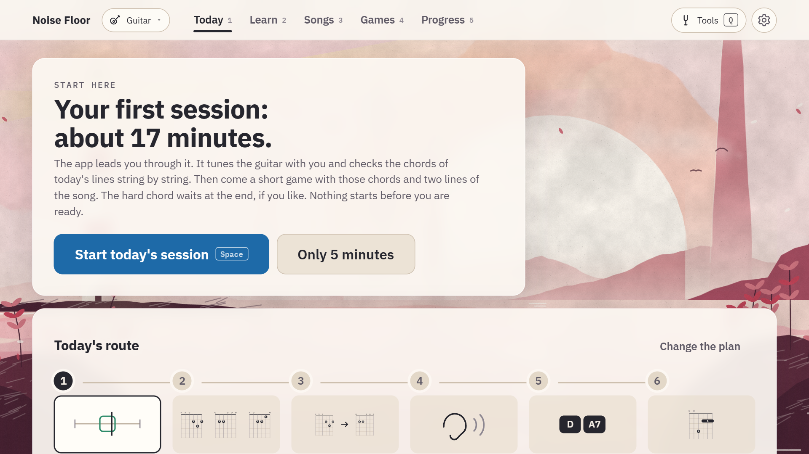
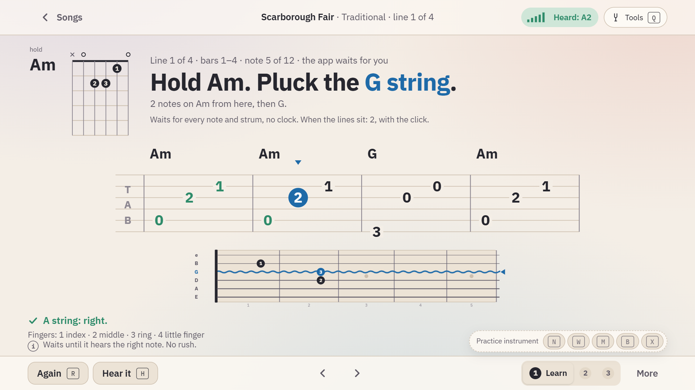
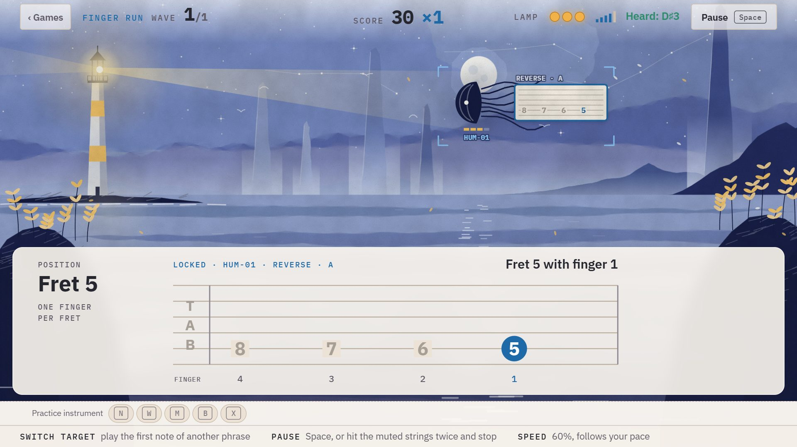
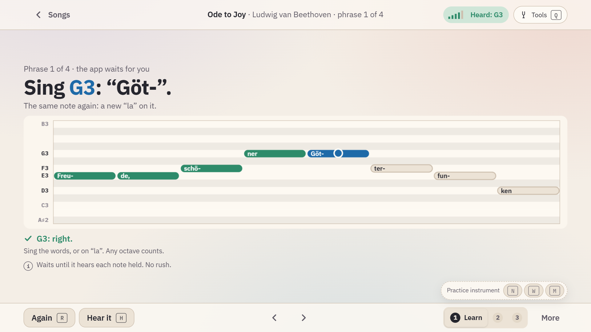

# Noise Floor

**Ein Trainer für Gitarre, Klavier und Gesang, der über das Mikrofon deinem echten Instrument zuhört, oder deiner Stimme.** Er läuft im Browser, auf Deutsch und Englisch, und nichts, was du spielst oder singst, verlässt deinen Computer.

[**Im Browser ausprobieren**](https://thorfinson.github.io/noise-floor/) · [English](README.md) · [Dokumentation (englisch)](docs/README.md) · [Wie die App hört (englisch)](docs/listening.md)



## Was es ist

- **Drei Spuren: Gitarre, Klavier und Stimme.** Jede hat ihre eigene tägliche Session von etwa einer Viertelstunde (oder fünf Minuten, die genauso zählen), eigene Songs, Spiele, Werkzeuge, ein Handbuch und einen Weg. Umschalten oben links, neben dem Namen.
- **Ein Song pro Woche, und ein Tag um ihn herum.** Auf der Gitarre wählst du einen Song für die Woche: einen von dreien, die zu dir passen, oder deinen eigenen, als Akkordblatt eingefügt. Leertaste drücken, und der Tag führt dich hindurch: Einspielen (nebenbei stimmen, dann ein Song, den du kannst, im Groove mit Band), ein Fokus, den der Song braucht (ein neuer Griff, sein schwerster Wechsel, sein Schlagmuster), sein nächster Teil, und als Zugabe die Nacht von heute. Heute zeigt den Song in seinen Teilen, deine erste und deine letzte Aufnahme nebeneinander und das Regal der Songs, die du ganz spielen kannst. Am Klavier übernimmt die App zuerst die Stimmung deines Klaviers; bei der Stimme findet sie zuerst deinen Umfang.
- **Lernen ist ruhig.** Eine Aufgabe nach der anderen: Erst wartet die App auf jeden Ton, dann spielst du mit Klick, dann den ganzen Song im vollen Tempo. Auf jeder Stufe vorher anhören, ein paar Takte in der Schleife üben, das Tempo in 5-%-Schritten von 25 bis 125 % stellen, mit der Band spielen oder ihn als Vortrag spielen und deine Aufnahme Takt für Takt anhören. Unter Kopfhörern spielt die volle Band; über Lautsprecher spielt sie um das herum, worauf das Mikrofon hört, und sagt dem Hörer, was sie spielt, damit sie nicht für dich gehalten wird (ein Lautsprecher-Test von etwa vierzig Sekunden sagt, ob dein Raum das erlaubt).
- **Was du gelernt hast, kommt wieder.** Ein Song, der ganz sauber lief, kommt in dein Repertoire und kehrt nach 3, 10, 30, 90 und 180 Tagen zurück, zwei Zeilen aus dem Stand; Akkorde werden in wachsenden Abständen neu bestätigt. **Fortschritt** zeigt den Weg, dein Repertoire und den Verlauf jeder Fähigkeit über die Wochen.
- **Über die Noten hinaus.** Motive deines Songs nach Gehör nachspielen, bevor du seine Tabulatur siehst; Schlagmuster erst abgedämpft, dann mit Akkorden; Riffs, Powerchords, die Moll-Pentatonik und Zupfmuster auf der Gitarre; beide Hände und die Notenzeile am Klavier; Text, Intervalle und eine zweite Stimme beim Singen; frei spielen über einem Bordun, und eigene Akkordfolgen machen. Rhythmen in Notenwerten lesen, Hammer-on und Pull-off üben, über den eigenen Akkorden singen, mit dem Text darüber, und mit Kapodaster oder tiefer gestimmt spielen.
- **Die Spiele sind es nicht.** Am Leuchtturm treibt im Takt Rauschen über das Meer, jeder Fetzen trägt einen Akkord: Schlag ihn an, und der Fetzen wird auf dem Schlag getroffen; eine Kette sauberer Wechsel holt die Band Schicht für Schicht dazu. Jeder Tag hat seine eigene Nacht, mit einer eigenen Regel. Bei den *Trittsteinen* überquert ein Wanderer das Wasser im Takt mit dem Klick. Bei *Freestyle* gibt es nichts zu lesen: Du spielst dein eigenes Solo über die Band, jeder Trick wird benannt und gezählt wie in einem Skate-Spiel, und eine Linie, die auf dem Grundton endet, bleibt als Lichtvorhang am Himmel. Alle sind wie Aquarelle gemalt und füllen das Fenster. *Mutproben* setzen deinen Song der Woche unter den Druck, den du wählst (Licht aus, jede Runde schneller, Akkorde einen Schlag vorher angesagt, nichts darf danebengehen, ein Take); *Fünf Töne* ist eine Melodie am Tag, nach Gehör zu finden.
- **Stufen werden gemessen, nie durch Zeit verdient.** Jeder Akkord, Wechsel, jedes Muster und jede Zeile eines Songs bekommt eine Stufe aus dem, was das Mikrofon gehört hat: wie schnell alle Saiten sauber klangen, wie viele saubere Wechsel pro Minute, bei welchem Anteil des vollen Tempos.
- **Gesang wird fair gemessen.** Die Stimme erscheint auf einer Tonhöhen-Spur, Songs werden in deinen Umfang gelegt, ein Ton zählt innerhalb von 50 Cent, gemessen an der Mitte dessen, was du gesungen hast, in jeder Oktave.
- **Songs ohne Urheberrecht:** 69 für die Gitarre (dazu 13 Übungen und 6 Songs in Powerchords), 110 Stücke für das Klavier (21 auch für beide Hände, 48 für beide Hände zusammen), 43 zum Singen (34 mit Text, die neun Instrumentalthemen in Solmisation), jeweils in vier Stufen mit Begründung. Volkslieder, Spirituals, Weihnachtslieder, Stephen Foster, und Bach, Beethoven, Mozart, Grieg, Joplin. 19 der Akkord-Songs sind ganz da, mit allen Strophen und Refrains und dem Text unter den Akkorden (je zwei bis vier Minuten). Eigene Songs kommen als Tabulatur, Notennamen, Akkordfolge hinzu, oder jeder Song als Akkordblatt, so wie du es von einer Songseite kopierst: Es bleibt auf deinem Rechner.
- **Gewohnheit ohne Druck.** Die Woche zählt, nicht eine ununterbrochene Kette von Tagen; ein einmal gemachter Plan, wann du spielst, kommt in deinen Kalender. Schritte weglassen, die du nicht brauchst, den Song der Woche unter dreien wählen, und den Fortschritt in einer eigenen Datei halten, um ihn auf einen anderen Computer mitzunehmen.

| | | |
|---|---|---|
|  |  |  |
| Einen Song Zeile für Zeile lernen | Noise Floor, das Spiel | Singen auf der Tonhöhen-Spur |

## Start

[Online](https://thorfinson.github.io/noise-floor/) in Chrome oder Edge benutzen, oder selbst starten (Node.js 20.19 oder neuer, oder 22.12 oder neuer):

```
npm install
npm start
```

`npm start` öffnet http://localhost:5173. Unter Windows tut ein Doppelklick auf `Noise Floor.cmd` dasselbe. **Heutige Session starten** drücken und das Mikrofon erlauben.

Kein Instrument zur Hand? **Einstellungen → Übungsinstrument zeigen** spielt Töne, Akkorde und eine Singstimme für dich (Tasten N, W, M) in denselben Hörer, den sonst das Mikrofon speist.

**Bevor du spielst:** Laptop oder Mikrofon etwa einen Meter vom Instrument entfernt aufstellen. Die Gitarren-Session beginnt mit dem Stimmgerät; die Klavier-Session misst das A deines Klaviers, weil ein altes Klavier selten auf 440 Hz steht; die Stimme-Session beginnt mit deinem Umfang. Wenn nichts reagiert: **Einstellungen → Mikrofon testen**.

## Datenschutz

Alles läuft in deinem Browser. Das Mikrofonsignal wird sofort ausgewertet und nie irgendwohin geschickt. Wenn du einen Song im vollen Tempo bis zum Ende spielst, wird dieser Durchgang aufgenommen, damit du ihn anhören kannst; Aufnahmen, Stufen und Einstellungen bleiben im Browser auf deinem Computer (**Einstellungen** schaltet das Aufnehmen ab, **Sicherung** speichert deine Daten in eine Datei). Es gibt keine Konten, kein Tracking und keinen Server. Einmal geöffnet, läuft die App auch ohne Netz.

## Was die App hören kann

Der Hörer wurde an Aufnahmen echter Instrumente und Sänger geprüft, nicht nur an synthetischem Klang: Er erkennt 71 von 71 Tönen einer Konzertgitarre und 49 von 49 Klaviertasten, unterscheidet 290 von 290 Akkordwechseln am Klavier (auch in einem simulierten Wohnzimmer und auf einem verstimmten Klavier), und auf 40 Aufnahmen von 29 Sängerinnen und Sängern hört er 98 % des Gesangs, 96 % seiner Messungen liegen innerhalb von 50 Cent der festgehaltenen Tonhöhe. Was er nicht kann und wie du eine Aufnahme schickst, wenn er etwas falsch hört, steht in [How it listens](docs/listening.md).

## Songs

Jeder Song, den die App mitbringt, ist gemeinfrei; Text gibt es nur zu Liedern, deren Worte ebenfalls gemeinfrei sind. Eigene Songs, die nicht veröffentlicht werden dürfen, kannst du nur auf deinem Computer behalten: siehe [Contributing](CONTRIBUTING.md#songs-you-keep-for-yourself).

## Entwicklung

```
npm test        # Unit-Tests: Hörer, Gesang, Mitspielen, Spielregeln, Stufen, Songbuch, Klavierbuch, beide Sprachen
npm run e2e     # Browser-Prüfungen in Microsoft Edge: Mikrofon, Übungsinstrument, Lesegrößen, Tablets, offline, Stimme, Deutsch
npm run check   # beides nacheinander: etwa vier Minuten auf einem Rechner mit sechzehn Kernen
npm run build   # Typprüfung und Produktions-Build
npm run samples # einmalig: Aufnahmen echter Gitarren, Klaviere und Stimmen für die Tests laden (etwa 680 MB)
```

Die Tests mit echten Aufnahmen werden übersprungen, bis `npm run samples` sie geladen hat. Wie man einen Song hinzufügt, die Regeln des Hauses und wo was liegt: [CONTRIBUTING.md](CONTRIBUTING.md).

## Credits und Lizenz

MIT, siehe [LICENSE](LICENSE). Schriften, Notenquellen und die Aufnahmen, an denen der Hörer geprüft wurde, stehen in [CREDITS.md](CREDITS.md).
