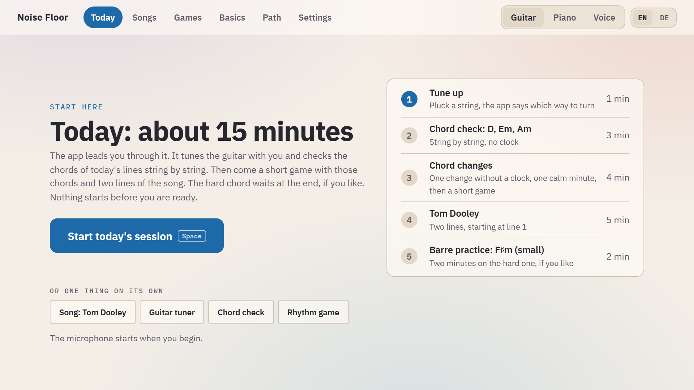
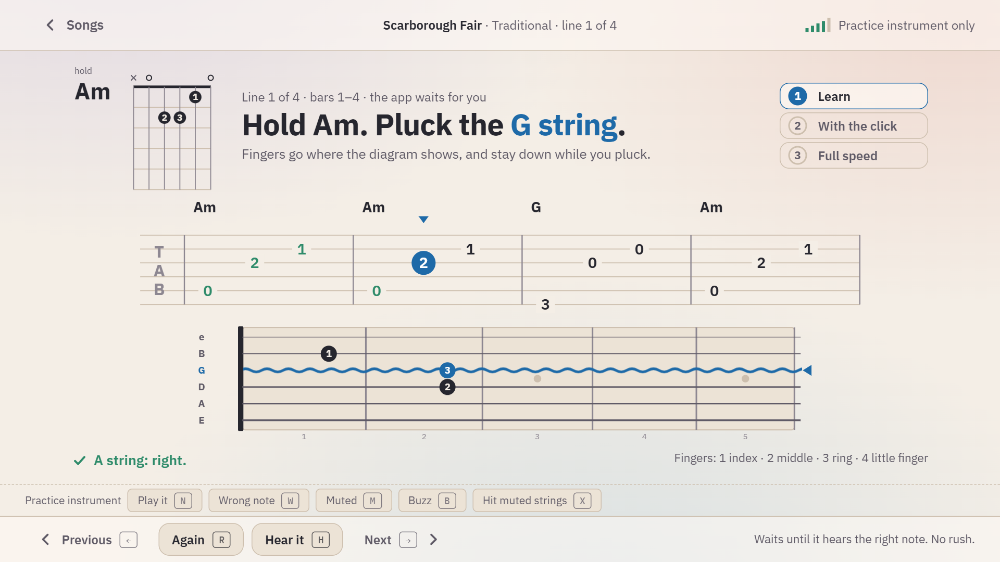
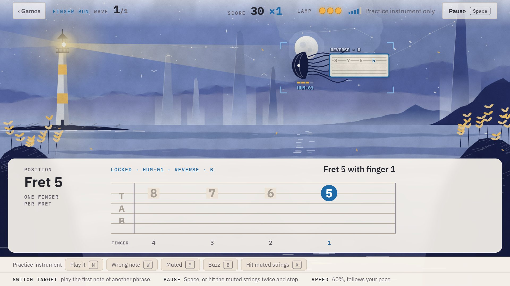
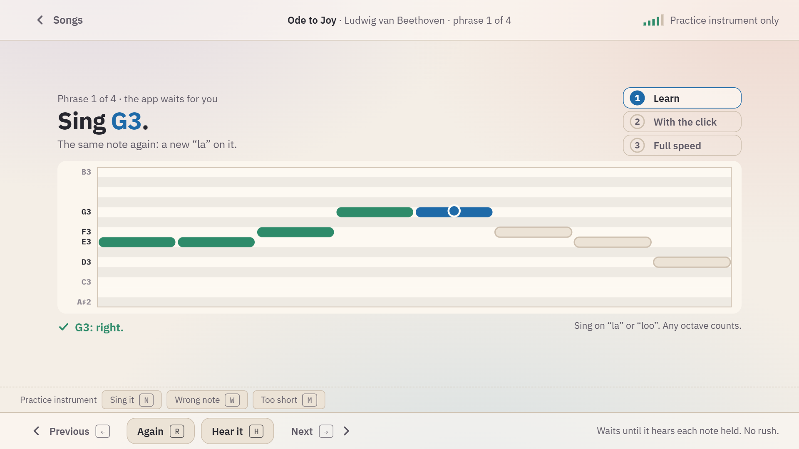

# Noise Floor

**Ein Trainer für Gitarre, Klavier und Gesang, der über das Mikrofon deinem echten Instrument zuhört, oder deiner Stimme.** Er läuft im Browser, auf Deutsch und Englisch, und nichts, was du spielst oder singst, verlässt deinen Computer.

[**Im Browser ausprobieren**](https://thorfinson.github.io/noise-floor/) · [English](README.md) · [Dokumentation (englisch)](docs/README.md) · [Wie die App hört (englisch)](docs/listening.md)



## Was es ist

- **Drei Spuren: Gitarre, Klavier und Stimme.** Jede hat ihre eigene tägliche Session von etwa zehn Minuten, eigene Songs, Spiele, ein Handbuch und einen Weg. Umschalten oben rechts.
- **Die App führt.** Leertaste drücken, und die Session führt dich hindurch: stimmen, die heutigen Akkorde Saite für Saite prüfen, ein kurzes Spiel, zwei Zeilen eines Songs. Am Klavier übernimmt die App zuerst die Stimmung deines Klaviers; bei der Stimme findet sie zuerst deinen Umfang.
- **Lernen ist ruhig.** Eine Aufgabe nach der anderen: Erst wartet die App auf jeden Ton, dann spielst du mit Klick, dann den ganzen Song im vollen Tempo.
- **Die Spiele sind es nicht.** Am Leuchtturm kommt Rauschen über das Meer, jeder Fetzen trägt eine Phrase; spiel sie sauber, und er platzt. Bei den *Trittsteinen* überquert ein Wanderer das Wasser im Takt mit dem Klick. Beide sind wie Aquarelle gemalt und füllen das Fenster.
- **Stufen werden gemessen, nie durch Zeit verdient.** Jeder Akkord, Wechsel, jedes Muster und jede Zeile eines Songs bekommt eine Stufe aus dem, was das Mikrofon gehört hat: wie schnell alle Saiten sauber klangen, wie viele saubere Wechsel pro Minute, bei welchem Anteil des vollen Tempos.
- **Gesang wird fair gemessen.** Die Stimme erscheint auf einer Tonhöhen-Spur, Songs werden in deinen Umfang gelegt, ein Ton zählt innerhalb von 50 Cent, gemessen an der Mitte dessen, was du gesungen hast, in jeder Oktave.
- **Songs ohne Urheberrecht:** 69 für die Gitarre, 106 Stücke für das Klavier, 43 zum Singen, jeweils in vier Stufen mit Begründung. Volkslieder, Spirituals, Weihnachtslieder, Stephen Foster, und Bach, Beethoven, Mozart, Grieg, Joplin. Eigene Songs kommen als Tabulatur oder Notennamen hinzu.

| | | |
|---|---|---|
|  |  |  |
| Einen Song Zeile für Zeile lernen | Noise Floor, das Spiel | Singen auf der Tonhöhen-Spur |

## Start

[Online](https://thorfinson.github.io/noise-floor/) in Chrome oder Edge benutzen, oder selbst starten (Node.js 20 oder neuer):

```
npm install
npm start
```

`npm start` öffnet http://localhost:5173. Unter Windows tut ein Doppelklick auf `Noise Floor.cmd` dasselbe. **Heutige Session starten** drücken und das Mikrofon erlauben.

Kein Instrument zur Hand? **Einstellungen → Übungsinstrument zeigen** spielt Töne, Akkorde und eine Singstimme für dich (Tasten N, W, M) in denselben Hörer, den sonst das Mikrofon speist.

**Bevor du spielst:** Laptop oder Mikrofon etwa einen Meter vom Instrument entfernt aufstellen. Die Gitarren-Session beginnt mit dem Stimmgerät; die Klavier-Session misst das A deines Klaviers, weil ein altes Klavier selten auf 440 Hz steht; die Stimme-Session beginnt mit deinem Umfang. Wenn nichts reagiert: **Einstellungen → Mikrofon testen**.

## Datenschutz

Alles läuft in deinem Browser. Das Mikrofonsignal wird sofort ausgewertet und nie aufgenommen, gespeichert oder irgendwohin geschickt; deine Stufen und Einstellungen liegen im lokalen Speicher des Browsers auf deinem Computer, und **Einstellungen → Sicherung** speichert sie in eine Datei. Es gibt keine Konten, kein Tracking und keinen Server.

## Was die App hören kann

Der Hörer wurde an Aufnahmen echter Instrumente und Sänger geprüft, nicht nur an synthetischem Klang: Er erkennt 71 von 71 Tönen einer Konzertgitarre und 49 von 49 Klaviertasten, unterscheidet 290 von 290 Akkordwechseln am Klavier (auch in einem simulierten Wohnzimmer und auf einem verstimmten Klavier), und auf 40 Aufnahmen von 29 Sängerinnen und Sängern hört er 98 % des Gesangs, 96 % seiner Messungen liegen innerhalb von 50 Cent der festgehaltenen Tonhöhe. Was er nicht kann und wie du eine Aufnahme schickst, wenn er etwas falsch hört, steht in [How it listens](docs/listening.md).

## Songs

Jeder Song, den die App mitbringt, ist gemeinfrei, und die App speichert keine Liedtexte. Eigene Songs, die nicht veröffentlicht werden dürfen, kannst du nur auf deinem Computer behalten: siehe [Contributing](CONTRIBUTING.md#songs-you-keep-for-yourself).

## Entwicklung

```
npm test        # Unit-Tests: Hörer, Gesang, Mitspielen, Spielregeln, Stufen, Songbuch, Klavierbuch, beide Sprachen
npm run e2e     # Browser-Prüfungen in Microsoft Edge: Mikrofon, Übungsinstrument, Stimme, Deutsch
npm run build   # Typprüfung und Produktions-Build
npm run samples # einmalig: Aufnahmen echter Gitarren, Klaviere und Stimmen für die Tests laden (etwa 680 MB)
```

Die Tests mit echten Aufnahmen werden übersprungen, bis `npm run samples` sie geladen hat. Wie man einen Song hinzufügt, die Regeln des Hauses und wo was liegt: [CONTRIBUTING.md](CONTRIBUTING.md).

## Credits und Lizenz

MIT, siehe [LICENSE](LICENSE). Schriften, Notenquellen und die Aufnahmen, an denen der Hörer geprüft wurde, stehen in [CREDITS.md](CREDITS.md).
