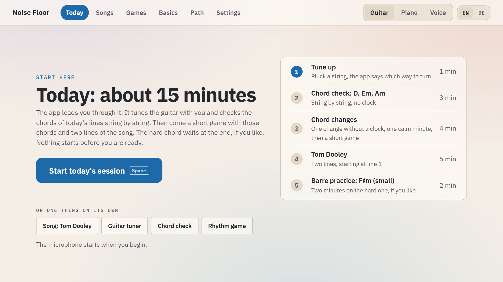
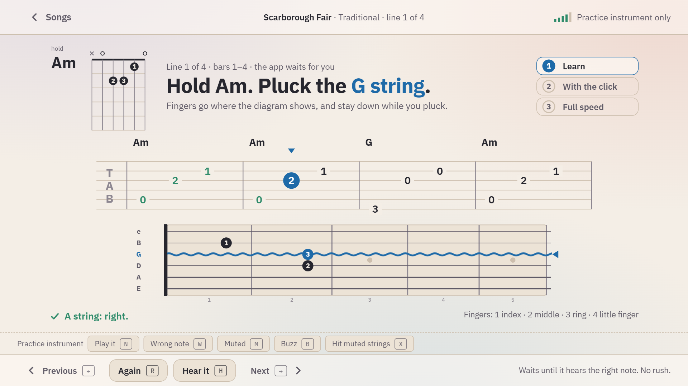
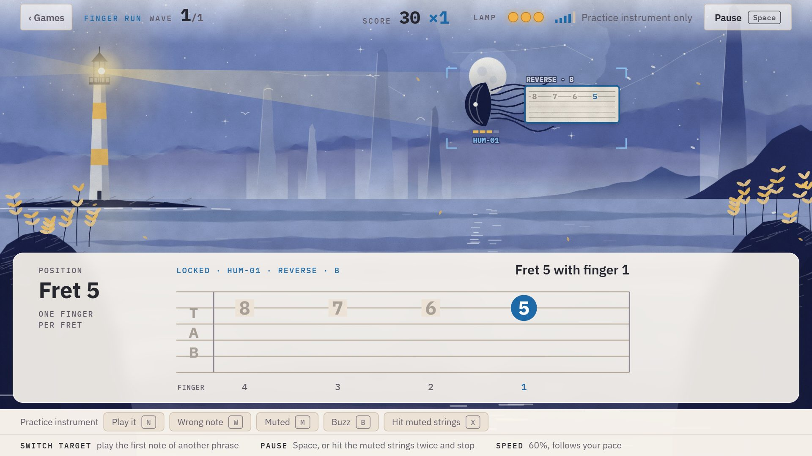
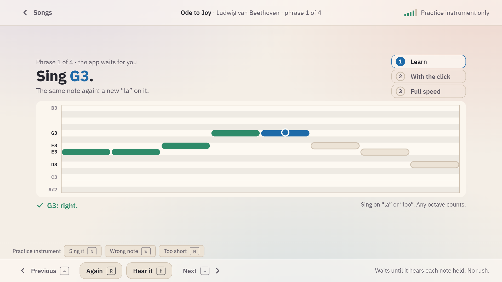

# Noise Floor

**A guitar, piano and singing trainer that listens to your real instrument, or your voice, through the microphone.** It runs in the browser, in English and in German, and nothing you play or sing leaves your computer.

[**Try it in your browser**](https://thorfinson.github.io/noise-floor/) · [Deutsch](README.de.md) · [Documentation](docs/README.md) · [How it listens](docs/listening.md)



## What it is

- **Three tracks: guitar, piano and voice.** Each has its own daily session of about ten minutes, its own songs, games, handbook and path. Switch at the top right.
- **The app leads.** Press Space and the session takes you through it: tune up, check today's chords string by string, a short game, two lines of a song. On the piano the app first adopts your piano's pitch; with the voice it first finds your range.
- **Learning is calm.** One task at a time: first the app waits for every note, then you play with the click, then the whole song at full speed.
- **The games are not.** At a lighthouse, noise comes in over the sea, each piece carrying a phrase; play it clean and it bursts. In *Stepping stones* a wanderer crosses the water in time with the click. Both are painted like watercolours and fill the window.
- **Levels are measured, never earned by time spent.** Every chord, change, pattern and line of a song gets a level from what the microphone heard: how fast all strings rang clean, how many clean changes a minute, at what share of full speed.
- **Singing is measured fairly.** The voice is shown on a pitch lane, songs are moved into your range, a note counts within 50 cents of its pitch, by the middle of what you sang, in any octave.
- **Songs free of copyright:** 69 for the guitar, 106 pieces for the piano, 43 to sing, each rated on four levels with the reasons spelled out. Traditional songs, spirituals, carols, Stephen Foster, and Bach, Beethoven, Mozart, Grieg, Joplin. Add your own as tab or note names.

| | | |
|---|---|---|
|  |  |  |
| Learn a song, line by line | Noise Floor, the game | Singing on the pitch lane |

## Start

Use it [online](https://thorfinson.github.io/noise-floor/) in Chrome or Edge, or run it yourself (Node.js 20 or later):

```
npm install
npm start
```

`npm start` opens http://localhost:5173. On Windows a double-click on `Noise Floor.cmd` does the same. Press **Start today's session** and allow the microphone.

No instrument at hand? **Settings → Show the practice instrument** plays notes, chords and a singing voice for you (keys N, W, M) into the same listener the microphone feeds.

**Before you play:** put the laptop or microphone within about a metre of the instrument. The guitar session starts with the tuner; the piano session measures your piano's A, because an old piano is rarely at 440 Hz; the voice session starts with your range. If nothing reacts, **Settings → Test the microphone**.

## Privacy

Everything runs in your browser. The microphone signal is analysed on the spot and never recorded, stored or sent anywhere; your levels and settings are kept in the browser's local storage on your computer, and **Settings → Backup** saves them to a file. There are no accounts, no tracking and no server.

## What it can hear

The listener was checked against recordings of real instruments and singers, not only synthesized sound: it names 71 of 71 nylon-string guitar notes and 49 of 49 piano keys, tells the chords of 290 of 290 piano chord changes apart (also through a simulated living room and a detuned piano), and on 40 recordings of 29 singers hears 98 % of the singing, with 96 % of its readings within 50 cents of the written-down pitch. What it cannot do, and how to send a recording when it gets something wrong, is in [How it listens](docs/listening.md).

## Songs

Every song that comes with the app is in the public domain, and the app stores no lyrics. Songs of your own that may not be published can be kept on your computer only: see [Contributing](CONTRIBUTING.md#songs-you-keep-for-yourself).

## Development

```
npm test        # unit tests: listener, singing, play-along, game rules, skills, songbook, piano book, both languages
npm run e2e     # browser checks in Microsoft Edge: the microphone path, the practice instrument, the voice, German
npm run build   # type check and production build
npm run samples # once: fetch the recordings of real guitars, pianos and voices for the tests (about 680 MB)
```

The tests against real recordings are skipped until `npm run samples` has fetched them. How to add a song, the rules of the house and where things are: [CONTRIBUTING.md](CONTRIBUTING.md).

## Credits and licence

MIT, see [LICENSE](LICENSE). Fonts, music sources and the recordings the listener is tested with are listed in [CREDITS.md](CREDITS.md).
