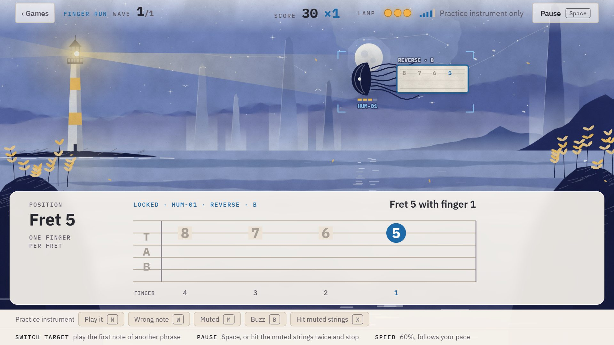

# Games

Learning is calm; the games are not. Runs drill what you already know; new songs are learned in a lesson first.

## Noise Floor, at the lighthouse

You keep the light. Noise comes in over the sea toward the lamp as blots of ink on the wing, each with a phrase on a slip of paper; the phrase of the nearest is shown large underneath (tab, chord shapes, keys or a tune to sing), read left to right. Every right note is a line of light from the lamp, the last one bursts the piece; a piece that reaches the lamp dims it, and three of those put it out. A wrong note only breaks your chain.

| | Runs |
|---|---|
| Guitar | finger gym (spider, reverse and skip patterns at the fifth fret), chord changes, song run |
| Piano | finger gym (five-finger patterns in C, G and F position, both hands), chord changes, piece run |
| Voice | voice gym (sung patterns in keys that suit your voice), song run |

- Every run starts with a page that says what it is and shows what it will ask for. It starts on your signal (Space, or a chord from the instrument), counts to four with the first phrase on show, and only then does anything move.
- The first wave sends one piece at a time, and the speed follows you: up when pieces are gone early, down when they get close to the lamp, so a run stays at the edge of what goes well. Phrases you are slow on come back more often.
- Six waves, with an upgrade to pick after each (longer chains, heavy air, a spare wick, clean sweep, even timing, ringing notes, quick changes). The evening goes on from wave to wave: rose evening, amber, dusk, night with the moon, a storm, the darkest hour under northern lights.
- At the end comes **the Mute**, a black disc with a ring of seals: a barre chord string by string on the guitar, a scale key by key on the piano, a scale sung up with the voice, without a clock. A run that was won ends in the dawn. Then a debrief: what the run made you play, and how it went against the run before.
- Inside the session a run is short: two waves, no Mute.

## Stepping stones

The game for rhythm, a side-scroller. A wanderer with a lantern crosses still water on stones, in time with the click; every stone is one strum (on the piano one chord struck, with the voice one sung "ta"), and the chord changes at every bar line. A stone met in time is lit and stays lit, so the way that was kept trails off behind; a long stretch in time sends birds up.

Four patterns (every beat; one and three; rest on two; a quick pair on three), each in a land of its own (a birch marsh at first light, a pinewood at noon, a heath in the evening, a coast at dusk), six tempi from 50 to 112 beats a minute. It says for every strum how early or late it was, notices one that is in time but still the old chord (or note), and a tempo counts when nine of ten stones were in time: then the beacon on the far bank is lit.

## How they look and sound

Both games are painted like watercolours on paper, in a few colours each: flat washes with uneven edges, far things pale in the mist and near things full, a large disc of bare paper for the sun or moon, fine hatching on the rocks. The picture fills the window; the panels of the game lie over it like sheets of paper. What does not move is painted once for each hour or land and kept (`src/ui/scene.ts`: washes laid down in many thin layers with a wandering edge, the settling of pigment, the grain of the paper); what moves is drawn over it every frame (`src/ui/watch.ts` for the lighthouse, `src/ui/trail.ts` for the walk). Everything is drawn by the code.

The sounds are small glassy chimes for a hit, a cleared phrase, a lit stone. Like the metronome tick they are made only of tones above the band the listener analyses, so the microphone may pick them up from the speakers; a test plays them at the listener as loud as a guitar and expects it to hear nothing.

`?hour=3` in the address of a run starts it at that hour of the evening (0 to 5). The screens you play at fill the window and never scroll, down to about 1280 by 600.

## From the instrument

Menu cards can be chosen by strumming Em, Am or C, or playing C, D or E on the piano (**Settings → Choose menu cards from the instrument**); with the voice the number keys choose. A guitar run can be paused by hitting the muted strings twice and then stopping (**Settings → Pause a run by muting the strings**).
