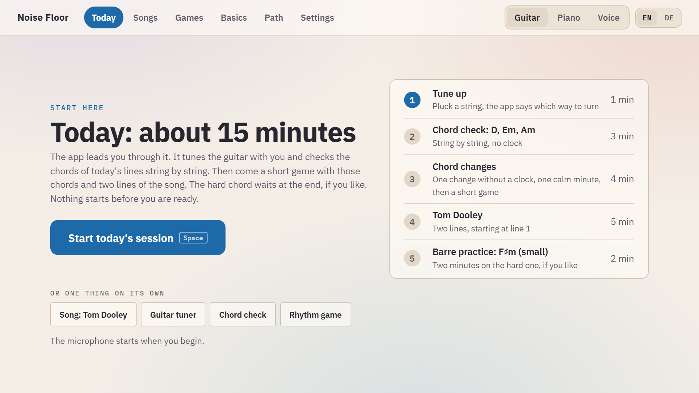

# Getting started

## Online or on your computer

The easiest way is the [online version](https://thorfinson.github.io/noise-floor/) in Chrome or Edge on a laptop or desktop. It is the same app; it runs entirely in your browser.

To run it yourself you need [Node.js](https://nodejs.org/) 20 or later:

```
git clone https://github.com/Thorfinson/noise-floor.git
cd noise-floor
npm install
npm start
```

`npm start` opens http://localhost:5173. On Windows a double-click on `Noise Floor.cmd` does the same (it installs what is missing the first time). `npm run build` writes a version you can put on any web server into `dist/`.

## The first session



At the top right you choose **Guitar**, **Piano** or **Voice**, and **EN** or **DE**. At first the app follows the language of your browser.

On the start page, **Today** shows the plan for the day: four or five steps, about ten minutes. Press **Start today's session** (or Space) and allow the microphone. The session leads you through it; each step moves on by itself when its goal is reached, and **Next step** is always there. A session left half-way is not lost: the start page offers to go on at the step where you stopped.

The first time a step comes up, a short page of the handbook explains it, with a picture and sometimes something to try while the app listens. All of them are under **Basics** too.

| | Guitar | Piano | Voice |
|---|---|---|---|
| 1 | Tune up | Play one A: the app adopts the piano's pitch | The first time your range; afterwards a held tone to warm up |
| 2 | Chord check: the chords of today's lines of the song | The finger gym before a tune; the chord check before a piece of chords | Match the tone: five notes sung back |
| 3 | A short game of chord changes | Chord changes, or the finger gym | The voice gym: sung patterns |
| 4 | Two lines of the song you are learning | Two phrases of the piece | Two phrases of the song |
| 5 | The hard chord, last and optional | | |

More about each in [Guitar](guitar.md), [Piano](piano.md) and [Voice](voice.md).

## Before you play

1. Put the laptop or microphone within about a metre of the instrument. For an electric guitar, the microphone needs to hear the amp or the unplugged strings.
2. **Guitar:** the session starts with the tuner. **Piano:** the session starts by measuring the A above middle C, because an old piano is rarely at 440 Hz. **Voice:** the first session finds your range.
3. If nothing reacts, see [Troubleshooting](troubleshooting.md).

## Without an instrument

**Settings → Show the practice instrument** puts a bar of buttons under every screen that plays for you, into the same listener the microphone feeds: **N** the right note, chord or sung tone, **W** a wrong one, **M** a muted (or too short) one, **B** a buzzing one, **X** a hit on muted strings. It is the way to look around the app, and it is what the browser checks use.

## Keys

| Key | What it does |
|---|---|
| Space | Start the session, a run or a walk; pause and resume |
| 1, 2, 3 | Pick a card, or a rung of a lesson (Learn, With the click, Full speed) |
| ← → | Lines of a lesson, strings of the tuner and of the chord check, pages of the handbook |
| R | Start over |
| H | Hear it: the app plays or sings the line first |
| − + | Slower, faster with the click |

## Settings

Language; microphone choice and test; a recording of what the app heard; metronome loudness and sound; loudness of the sounds of the games; timing with the click; small barre shapes; menu cards chosen from the instrument; pausing a run by muting the strings; the practice instrument; tuning references for the guitar and the piano; buzz tolerance and how long a string must ring; your vocal range and how near a sung note must be; backup to a file and back; erasing everything.
