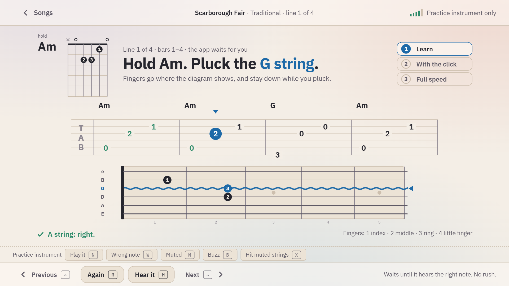

# Guitar

## The session

1. **Tune up.** Pluck any string: the app sees which one it is, says which way to turn, and ticks it off when it is in tune. Any string can be tuned at any time; a ticked string is measured again whenever it is plucked, and loses its tick when it has gone off (as it does when the wrong peg was turned). <kbd>←</kbd> <kbd>→</kbd> or a click pick a string by hand, for one so far off that it sounds like its neighbour.
2. **An old song, from cold**, when one is due (see [Levels](levels.md#songs-that-come-back)): two lines of a song you can already play, at full speed, with no run-up.
3. **Chord check.** Three open chords a session, with the fingering in a diagram and in words: first the ones today's lines of the song need, then other new ones, easiest first (Em, Am, E, A, D, C, G, Dm), then the ones whose time has come to be confirmed again, then the ones that need it most. Hold the chord and pluck one string at a time: each is called clean, muted, buzzing, or the wrong string. A string that will not ring is left for next time after three tries; <kbd>←</kbd> goes back a string, <kbd>→</kbd> skips one. A chord that already rings is asked for from memory: its picture stays hidden until you press S or a string does not ring.
4. **One change, then the game.** The session takes the change that is furthest from 30 a minute, has you make it without a clock (the app waits and says how: which fingers stay down, which keep their shape and move together), then counts it over one calm minute, and only then starts a short run of chord changes with chords that have already rung clean.
5. **By ear, or the strumming hand.** Three motifs of the song to play back before its tab is shown (for a song of strummed chords: three chords you know, told apart by their sound). When the song's strumming pattern is new and its chords already ring, the strumming trainer takes this place: a new chord never comes together with a new pattern. On a day with an old song from cold, this step is left out.
6. **The song.** Two lines of the song you are learning.
7. **The hard chord**, last and optional: a barre chord the song needs, otherwise the next one on the way to F♯m and Bm.

**Only 5 minutes** on the start page is the first step and the song; it counts as fully as the whole session.

## Lessons

A song is learned on three rungs:

- **1 Learn:** the app waits for every note or strum. A string that is struck but does not ring is called dead, a wrong note is named. A bar that slipped is played once more, alone, before the lesson moves on.
- **2 With the click:** one line at a time with a metronome and a marker that moves through the tab. It moves on when the line was clean, gets faster when the whole song was, and slower when a line falls apart twice; a take that fell apart is followed by a take of only the bar that slipped.
- **3 Full speed:** start to end, the line you play on top and the next one underneath. Every take at full speed is recorded (see below).

The app picks the rung from what you have proved; keys 1, 2, 3 change it. Tab is read left to right; a strummed song shows its pattern (a long stroke down, a short one with a tip for the way back up) and names each chord where it begins, also in the middle of a bar. A picked song also comes in a basic version: the same chords, one slow strum on every click. While the chord stays, the line under the instruction says how many strokes are left and what comes next ("4 strums of G from here, then the change to C").

| Key | In a lesson |
|---|---|
| H | **Hear it**, on every rung: the line as it should sound; on rung 1 a little slower than full speed, with the click at the tempo you practise at. During a take it pauses the take: the model is heard between tries, never over one. What the microphone picks up of it is not counted. |
| − + | The tempo in steps of 5 %, from 25 % up to 125 % (beyond the song's own speed, to have room to spare). |
| L | **Loop:** the bars on show go round and round with the click, one bar counted in, until L again. **[** and **]** take in the bar before or after. Clean bars are measured as on rung 2; after three clean runs in a row the tempo rises by 5 % (**Settings → in a loop the tempo rises by itself** is on by default). |
| A | **Backing:** a soft bass and the chords under the click. For headphones only: through speakers the microphone would hear it as playing. |
| E | **By ear:** on rung 1 the line is played first and its notes stay hidden; T shows them. |
| V | **Performance:** the whole song from the top at full speed with no marks while you play. Afterwards you say how many slips you heard (0 to 3) before the app says how it heard it; both are kept, so that you can see how your own ear and the app's compare. |
| P | Listen back to the recording of the take. |
| I | **Rest the hands:** the app plays the line and shows each note on the tab and the fretboard as it sounds; nothing is listened to or measured. Follow it with your eyes, then once more with them closed: practice in the head, for sore fingertips and beside real playing. |
| K | **Words** under the notes of a tune whose melody has free words (Oh! Susanna, Aura Lee, Drunken Sailor …). |

The second level of these (backing, by ear, resting the hands, words, performance; and on the piano the staff) is under **More** in the bar at the bottom. A song of chords whose words are free also has **Sing and play** there.

**Recordings.** A take at full speed is recorded and kept in this browser: the first recording of each song and the latest, so that weeks of practice can be heard side by side. Under the music the bars of the take are shown as a row (green the ones the app heard clean); pick one to hear only that bar. **Save as a file** gives the take as a WAV file to keep or to send. All recordings of a song are under **Progress → Repertoire → Recordings**. **Settings → Record takes at full speed** turns it off.

## Chords and changes

- **Chord check** (`#/chord/Am`): one chord, string by string, outside the session too.
- **Chord change** (`#/change/Em/Am`): three times there and back without a clock, with how the change is made, then one calm minute in which every clean change is counted. 30 clean changes a minute keep a song going; at 60 a change no longer needs practice.
- **Small shapes.** F♯m and Bm also come as small shapes on four strings, the step before the full barre (**Settings → Small shapes for barre chords**). Songs show them until the full barre has rung clean.
- **Stage check.** When all eight open chords ring clean, the learning path offers a check: all eight in a row, from memory.
- **Chord library** (`#/chords`, under **Tools**): every shape the app knows, in groups (open, sevenths, colours, small shapes, full barre, power chords), with your level for each; pick one to check it.

## The strumming hand

**Tools → Strumming** (`#/strum/folk`): a pattern of strokes down and up, read left to right, with the count under it ("1 + 2 + …"), played to the click in three steps: on muted strings, counting out loud; on one chord the left hand already knows; with a change of chord at the bar line. Two clean takes lead to the next step, then to a faster tempo. The app hears when each stroke falls, not which way the hand moved: the arrows are there to be followed, the timing is what is judged. The patterns: every beat, eighths, down down-up, down down-up up-down-up, three-four, six-eight, sixteenths.

## Beyond open chords

Exercises of the app's own, learned in lessons like songs, each a stage beside the path:

- **Riffs:** four lines of single notes on the low strings (the low E, a walk on the A string, the gallop, a blues line).
- **Power chords:** E5, A5, D5, G5, C5, F5, B5, and six songs of the songbook in a version for them, eight strokes down a bar.
- **The minor pentatonic** at the fifth fret, up and down, one finger per fret, and three licks in it.
- **Picking patterns:** bass and two fingers, four to the bar, rolling in six, eight to the bar, the thumb alternating.

In the song list they are tagged "exercise" and have a filter of their own. The session never chooses one by itself.

## By ear

**Tools → By ear** (`#/ear`): the app plays, you play it back, without looking. *Play it back*: two to four notes from the song you are learning (longer as the ear gets better). *Which chord?*: one of the chords that ring for you, told apart by playing it. *Sing it, then play it*: the motif sung first, then found on the instrument. A round counts how many were found at the first try, without asking to see them (T).

## Playing freely and your own song

- **Tools → Play freely** (`#/jam`): the minor pentatonic at the fifth fret, over a drone on A if you like (headphones). Whatever you play, the app shows on the fretboard and in a row, blue in the scale, amber outside it. No score, no clock.
- **Tools → Your own song** (`#/compose`): a chord progression of your own, chord by chord (the ones that ring for you first), a strumming or picking pattern, a tempo. **Hear it** plays it without the microphone; **Keep it and learn it** makes it a song like any other.
- **Songs → Add a song from a tab**: paste a text tab (six lines, bars split by `|`, numbers in one column are played together; spacing can be read as rhythm). It gets a level like every other song.

## Sing and play

**Tools → Sing and play** (`#/singalong/…`, also from a song's **More**): the chords of a song over its words, four bars a line, with the click counted in; under headphones the melody to sing to, or a backing. The app listens to the guitar only, and a bar turns green when its chord was heard in it. Nothing is measured: on real recordings with a singer mixed in as loud as the guitar, the chord of 94 % of the stretches was still heard, but 13 % of the strums were covered by the voice (5 % without it). Seven songs: Oh! Susanna, Skip to My Lou, Auld Lang Syne, Jingle Bells, La Cucaracha, Drunken Sailor and Amazing Grace.

## Reading rhythm

**Tools → Reading rhythm** (`#/rhythm`): two bars of 4/4 in note values on one line, with the count under each note, played with the click on muted strings: quarters and halves, eighths, rests, dotted quarters, off the beat, sixteenths. Two clean takes bring the next rhythm, every rhythm of a level clean the next level. The app hears when each stroke falls, as in the strumming trainer.

## Hammer-on and pull-off

**Tools → Hammer-on and pull-off** (`#/slur`): six patterns on the G and B strings, the slurs drawn as arcs with h and p over the tab. The app follows the pitch and waits until each note sounds; a hammer-on struck too softly, or a pull-off that does not pluck the string, gives no second note, which is the commonest fault. Tested on real recordings: the pitch reached the note of 21 slides of 21 on three electric guitars, and the second of recorded notes joined without a new attack 143 times of 144. Whether a note was hammered or plucked again the app cannot hear (an onset is reported either way): a hammer-on keeps one sound going, and the ear can tell.

## Capo and tunings

**Settings → Capo** (frets 1 to 7) and **Settings → Tuning of the guitar** (standard, a half or a whole step down): the app hears with its reference A moved by as much, so a C shape stays a C shape and every song, chord and exercise works as written; the top line of a lesson says "capo 2". The tuner tunes seven tunings: standard, a half and a whole step down, Drop D, Open G, Open D and DADGAD. The last four move single strings, which changes what a shape sounds like; they are for playing of your own, and the tuner says that the lessons expect the guitar tuned back.

## Left-handed

**Settings → Left-handed guitar** mirrors the chord pictures and the fretboard: the high e string on the left, the nut on the right, as a left-handed player sees the guitar. Tab stays as it is written for everyone.
