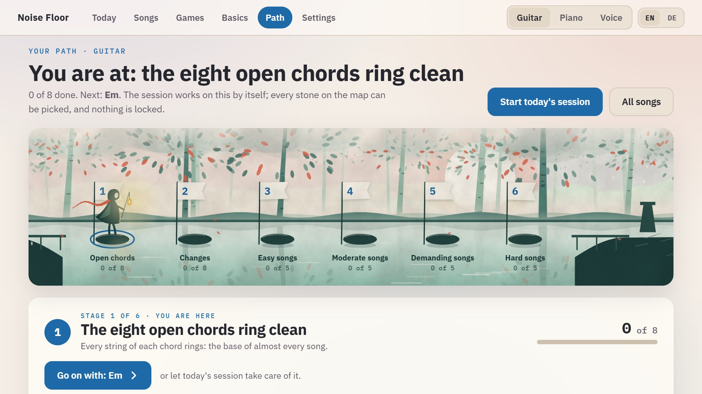

# Levels and the path

## Measured skill

Every chord, change, pattern, scale, rhythm and line of a song has a level from 0 to 5, granted only for what the microphone heard. Levels are never earned by time spent, and they never go down. A skill not confirmed for a week is marked rusty, and rusty and low skills come up more often in runs. The rank is the total of all levels.

| Skill | Measured as | Levels 1 to 5 |
|---|---|---|
| Chord | time from the moment the chord is shown until all its strings rang clean; on the piano until each key and the chord as a whole rang | all clean once, then within 30, 15, 8, 5 seconds |
| Chord change | clean changes a minute | 10, 20, 30, 45, 60 |
| Finger pattern | clean tempo in beats a minute, two notes to the beat | 60, 80, 100, 120, 140 |
| Song bar, piano phrase, sung phrase | share of full speed, played without a slip | 50, 70, 85, 100 %, then 100 % three times |
| Scale (piano, voice) | time until every key rang on, or every note was held | all clean once, then within 30, 16, 10, 7 seconds |
| Keeping the beat | the tempo at which nine of ten stones were in time | 50, 60, 72, 84, 100 |
| Tones sung back | how far off the five notes were on average | within 60, 40, 28, 18, 12 cents |
| A held tone | how much the voice wavered round its own middle | within 40, 28, 20, 14, 9 cents |
| Sung patterns | notes a minute found on pitch | 30, 45, 60, 80, 100 |

Each instrument measures for itself: C on the piano is another skill than C on the guitar. With the click, a bar counts at the speed of the click when every note in it was on time and nothing else was played. The thresholds live in `src/core/skills.ts`.

## How hard a song is

Every song and piece has one of four levels (easy, moderate, demanding, hard) with the reasons spelled out, worked out from its notes, so songs you add get one too.

- **Guitar, strummed:** points for the hardest chord shape (an awkward open shape 1, a small barre 2, a full barre 3), one more for two or more full barre chords, one for more than three chords and two for more than five, one for a strumming pattern with upstrokes, one when the changes come faster than every two seconds. Picking counts two, a tune one, and their pace up to two more. Up to 1 point is easy, 2 moderate, up to 4 demanding, more is hard. A song is rated by the easiest shapes the app offers (the small F♯m and Bm), so its level does not change when you learn the full barre.
- **Piano:** a tune by what the hand has to do (stay in one five-finger position, move between phrases, move inside them), its black keys, its pace and how many different phrases it has. Chords like the guitar's: the hardest shape (three white keys 0; a black key in the middle or a fourth key 1; a shape that starts on a black key or has two 2; four keys of that kind 3), how many chords, how far the hand jumps, the pattern and the pace.
- **Voice:** how wide the song is (a fifth, an octave, more), its widest leap, notes outside its key, its pace, and how many different phrases it has.

Under each song the list says what it asks of you: which of its chords already ring. Until you open a song yourself, the session works on the easiest one that is not finished; when all of it has been played clean at full speed, the session moves on to the next.

## The path

**Path** shows where you are, what you can do and what comes next, as a map: stepping stones over water, one stone for each stage, the wanderer of the rhythm game on the stage you are at, a flame on every stage that is done. Any stone can be picked: under the map its sheet opens with what the stage gives you, how far it is, a button for the next thing to do, and every chord, change or song of it as a tile (done, in work, new, rusty). Nothing is locked. It also says on how many different days something was measured clean, because one good day may be luck.

| | Stages | Beside the path |
|---|---|---|
| Guitar | the eight open chords ring clean; changes at 30 a minute; five songs of each level | the barre ladder; independent fingers |
| Piano | five fingers in each hand; the first six chords; their changes; five pieces of each level | scales; chords with black keys and sevenths |
| Voice | your range measured and tones sung back in tune; sung patterns; five songs of each level | nearer and steadier; the sung scale |

Below the map, everything measured: rank, days played, best scores, and each kind of skill folded away under its name with level, best value and what the next level needs.
