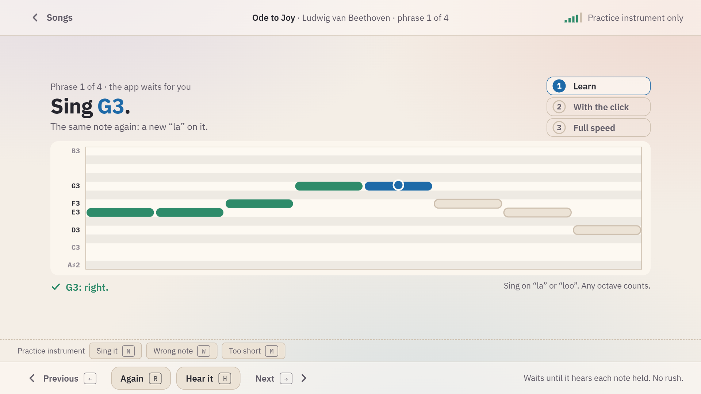

# Voice

The voice track was built after comparing how singing apps (Singing Carrots, Yousician, Simply Sing, SingSharp, Vanido, SingTrue) and singing research measure a voice, and takes their common ground. Songs are sung on "la"; words are not judged, only pitch and timing.

## The session

1. **Your range** the first time (`#/range`): glide down to a low note that is still easy and hold it a moment, then up to a high one. Songs are then set two semitones inside it, a little above the middle, because an untrained voice tends to sit low. Measure it again in a few weeks: it grows. The app gives no voice-type label, only where the songs are set. Later sessions start with **a held tone** to warm up (`#/hold`): five seconds on one note, as steady as you can.
2. **Match the tone** (`#/match`): the app sings a note in a voice-like "oo", you sing it back and hold it until the ring round the dot is full. Five notes from the middle of your voice.
3. **The voice gym:** sung patterns at the lighthouse (a step, a third, do-mi-sol, five notes up and down, thirds), in three keys that suit your voice, the middle one with its third on the middle of your range.
4. **The song** (`#/sing/<id>`): two phrases.

## The pitch lane

Time runs left to right, pitch bottom to top, one row per semitone, the rows of the black keys a little darker. Each note to sing is a bar at its height, as long as the note lasts; your voice is a line and a dot. A ring round the dot fills while you hold a note. A bar the voice lay on turns green; one sung close (between 50 and 100 cents off) turns amber, and is not shown as a failure.

## Songs on three rungs

- **1 Learn:** the app waits until it hears each note held. The same note twice needs a new start (a new "la" or a breath). Staying on the note you just sang while you find the next one is waiting, not a slip. **H** sings the phrase for you first.
- **2 With the click:** each note is judged by the middle of what was heard in it, leaving out the first fifth of a second (a voice slides into a note) and the end.
- **3 Full speed:** from the phrase you are at to the end.

## How it measures

- **Within 50 cents** counts as on the note: the right semitone, as singing studies use. **Settings → How near a sung note must be** offers 35, 50 or 75 cents.
- **By the middle.** A held note counts when the middle of the readings of the last quarter second lies near it and at least half of them lie inside the band. A voice with vibrato swings round its note by half a semitone and more and is heard on it; on recordings of 29 singers this takes 99 of 100 held notes as held, and a note a semitone off about once in a hundred (see [How it listens](listening.md)).
- **Any octave.** A low voice and a high one sing the same songs. A pitch reading that jumps an octave for an instant is a slip of the tracker and is moved back.
- **Call and response.** While the app sings, it does not listen, so its own voice is never taken for yours.

| Measured | As | Levels 1 to 5 |
|---|---|---|
| Tones sung back | how far off the five notes were on average, in cents (at least four of five found) | within 60, 40, 28, 18, 12 cents |
| A held tone | how much the voice wavered round its own middle over five seconds | within 40, 28, 20, 14, 9 cents |
| Sung patterns | notes a minute found on pitch, one after the other | 30, 45, 60, 80, 100 |
| The sung scale | time for eight notes up, each held on pitch | all once, then within 30, 16, 10, 7 seconds |
| A phrase of a song | share of full speed, without a slip | 50, 70, 85, 100 %, then 100 % three times |

## Games

- **Voice gym** and **Song run** at the lighthouse: the tune of each piece of noise is shown with its notes named in the scale and drawn higher and lower. A note counts once held on pitch for a quarter of a second, in any octave; a note held clearly elsewhere breaks the chain. The Mute at the end is a major scale sung up, one seal for each note.
- **Stepping stones** with the voice: one short sung "ta" on each stone, on a note that changes every bar (do, then mi).

## The handbook of the voice

Nine pages in four chapters: standing and breathing, warming up; finding a note, reading the lane, holding a tone; steps and leaps, the beat; your range, looking after your voice. Practise little and often, drink water, and stop when the voice gets hoarse or tired.

## What it cannot tell

How a note is produced (support, strain, registers) is not something a pitch can show. The real voices it was tested with sang their own songs, close to the microphone; how your voice, microphone and room come through is yours to find out.
